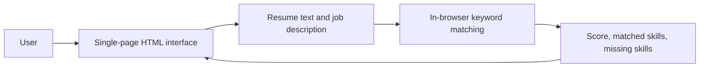

# AI Resume + Job Matcher

<strong>A single-page, browser-only prototype that compares resume text with fictional sample roles or a pasted job description and highlights shared keywords.</strong>

HTML · CSS · JavaScript · Local heuristic analysis

## Project overview

Paste resume text or select a UTF-8 text file, choose one of ten bundled fictional sample jobs, or paste a custom job description. The page calculates a keyword-overlap score, groups matched and missing terms into skill categories, and displays a results breakdown.

## Architecture

No server, AI model, database, or external resume parser is included. Sample jobs are fictional and scoring uses a fixed keyword list. Results show keyword overlap only; they are not hiring decisions, role-fit assessments, or validated ATS scores. Resume text is processed locally in the browser and is not uploaded.

## Run locally

Open [`index (1).html`](index%20%281%29.html) in a modern browser. No install or build step is required. For a local web server, serve the repository directory with any static-file server.

## Use it

1. Paste resume text, or select a UTF-8 `.txt` file (maximum 1 MB) and review the extracted text. PDF, DOC/DOCX, and RTF parsing are not implemented.
2. Select a sample role or paste a job description.
3. Choose **Analyze Match** and review the score and skill categories.
4. Edit the inputs to compare a different role.

PDF/DOCX parsing is not implemented; the upload logic reads text and should not be relied on to extract formatted documents accurately. The browser performs the analysis locally in the page.

## Project structure

- `index (1).html` — page markup, styles, sample jobs, and matching logic
- `LICENSE` — repository license
